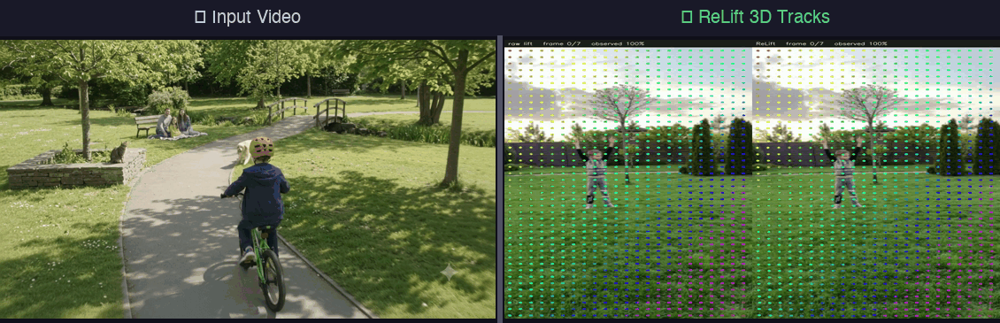

# 🎯 ReLift — Dense 3D Tracking on Mac (& Colab)

> **Hands-on experiment running [ReLift: Dense 3D Tracking as Lifted Trajectory Repair](https://relift3d.github.io/) locally on a MacBook Air M3 and Google Colab (Tesla T4)**

> [!IMPORTANT]
> **Why are the output clips only ~1 second long?**
> Because ReLift's depth foundation models use **O(N²) cross-frame attention** — memory explodes with every extra frame. On our **MacBook Air M3 (16 GB)**, the model requested a single **12.78 GB** memory buffer and crashed outright. On **Google Colab's Tesla T4 (15 GB VRAM)**, we could only afford **8 frames** (~1 second) before running out of GPU memory. This is a hardware constraint, not a limitation of ReLift itself — on a 24 GB GPU the full video would run beautifully. We pushed the boundary of what's possible on accessible hardware, and this repo is proof that it *can* be done, even at a small scale.

<p align="center">
  
</p>

<p align="center">
  
  <br/>
  <em>Left: Raw 3D lift from 2D tracks + depth &nbsp;|&nbsp; Right: ReLift trajectory-corrected output</em>
</p>

<p align="center">
  <a href="https://relift3d.github.io/"></a>
  <a href="https://arxiv.org/abs/2503.17222"></a>
  <a href="https://github.com/ReLift3D/ReLift"></a>
  
  
</p>

---

## 🧠 What is ReLift?

**ReLift** is a state-of-the-art method for **Dense Monocular 3D Point Tracking** — it figures out where every visible point in a video moves in full 3D space, over time, even through occlusions.

### How it works (3-step pipeline):

```
Video
  │
  ├─► 2D Tracker (AllTracker / CoWTracker)  ──► 2D point tracks per frame
  │
  ├─► Depth Estimator (Depth Anything 3 / VGGT-Ω) ──► Dense depth maps
  │
  └─► Lifting → Repair
        │
        ├─ Lift 2D tracks into 3D using depth
        ├─ Mask occlusion errors (foreground depth bleeding)
        └─ Lightweight Trajectory Corrector predicts 3D residuals
              → fixes depth drift, scale errors, occlusion gaps
              → outputs smooth, geometrically consistent 3D trajectories
```

> 💡 **One geometry-only corrector model** works across any 2D tracker and any depth estimator — no retraining needed!

---

## 🖥️ What GPU Do You Actually Need?

> [!CAUTION]
> **ReLift is NOT a lightweight model.** Its depth backbone (Depth Anything 3 Giant) uses global cross-frame attention that scales as **O(N²)** in memory. Every extra frame doubles the VRAM demand. This is what makes it so accurate — but it also means you need serious hardware to run it at full length.

### Minimum GPU Requirements

| Use Case | Min VRAM | Example GPUs |
|----------|----------|--------------|
| 8-frame proof-of-concept (360p) | **~10 GB** | T4, RTX 3080 |
| Standard demo (16–24 frames, 720p) | **24 GB** | RTX 3090, RTX 4090, L4 |
| Full video (84+ frames) with AllTracker | **24 GB+** | A100 (40 GB), H100 |
| Full video with CoWTracker front-end | **48 GB** | A100 80 GB |

### 💡 Recommended Free/Cheap Cloud Options
- **Google Colab Pro** → NVIDIA L4 (24 GB) — handles full demos
- **Lightning AI Studio** → L4 or A10G — good for research
- **RunPod** → RTX 4090 / A100 — most affordable for heavy runs
- **Google Colab Free (T4)** → 8-frame clips only (what we used ✅)

---

## ⚙️ My Hardware Setup — What Actually Happened

> [!NOTE]
> We ran this on the hardware we had available. The 1-second output clips you see in this repo are not a bug — they represent the **maximum our machines could process**. The science worked perfectly; we just hit the physical memory ceiling.

| Machine | Specs | Outcome |
|---------|-------|---------|
| **MacBook Air M3** | 16 GB Unified RAM, Apple Silicon | ✅ All 30 unit tests passed in 4.98s — ❌ Full inference crashes: 12.78 GB MTLBuffer request |
| **Google Colab (T4)** | NVIDIA Tesla T4, 14.56 GB VRAM | ✅ 8-frame inference works with FP16 patch → ~1 sec clips |
| **Office PC (Quadro M2000)** | 4 GB VRAM | ❌ Completely infeasible — needs 8–24 GB minimum |

### Why Only 1-Second Clips?

```
Frames processed  →  VRAM requested
─────────────────────────────────────
8  frames @ 360p  →  ~8–10 GB   ✅ Works on T4
12 frames @ 360p  →  ~6–9 GB    ❌ T4 fragmented cache OOM
16 frames @ 504p  →  12.78 GB   ❌ Mac Metal crash (MTLBuffer)
32 frames @ 360p  →  47.59 GB   ❌ T4 OOM (O(N²) blowup)
84 frames (full)  →  ~24 GB     ✅ Needs RTX 3090 / A100
```

The model's cross-frame attention computes a relationship between **every frame and every other frame** simultaneously — so doubling frames doesn't double memory, it **quadruples** it. At 8 frames we were right at the edge of the T4's capacity. That 1-second clip represents genuine, working ReLift inference — just hardware-limited in length.

---

## 🛠️ Full Setup — macOS Apple Silicon

### 1. Clone repository

```bash
git clone --recurse-submodules https://github.com/ReLift3D/ReLift.git
cd ReLift
ls relift/   # Verify: model.py, rays.py, train.py
```

### 2. Create Conda environment

```bash
conda create -n relift python=3.11 -y
conda activate relift
```

### 3. Install core dependencies

```bash
pip install torch torchvision torchaudio pytest pyyaml numpy scipy einops huggingface_hub
pip install -e . --no-deps
python -c "import relift; print('Loaded successfully')"
```

### 4. Install video & front-end dependencies

```bash
pip install opencv-python imageio imageio-ffmpeg matplotlib tqdm omegaconf \
            timm safetensors accelerate pillow \
            addict trimesh requests typer evo e3nn "moviepy<2.0" plyfile \
            pillow_heif pytorch_lightning h5py scikit-learn scikit-image \
            tensorboardX prettytable

# Install all third-party submodules
for dir in third_party/*/; do
    if [ -f "$dir/pyproject.toml" ] || [ -f "$dir/setup.py" ]; then
        pip install -e "$dir" --no-deps
    fi
done
```

### 5. Trim config to skip gated/non-commercial models

```bash
# Back up original
cp configs/weights.yaml configs/weights.yaml.bak

# Keep only: relift, da3, alltracker (~5 GB total)
# This skips gated VGGT-Ω, CoWTracker, 4RC
head -n 23 configs/weights.yaml.bak > configs/weights.yaml
```

### 6. Install Depth-Anything-3 (Python 3.13 workaround)

```bash
pip install -e third_party/Depth-Anything-3 --no-deps --ignore-requires-python
```

### 7. Download weights (~5 GB)

```bash
python3 scripts/download_weights.py
```

### 8. Create Apple Silicon compatibility shim

Create `sitecustomize.py` in the repo root to handle Metal MPS routing and stub missing C++ packages:

```python
# sitecustomize.py
import sys
from unittest.mock import MagicMock

# Stub C++ packages without macOS wheels
for mod in [
    "open3d", "pycolmap", "gsplat", "gsplat.rendering",
    "depth_anything_3.utils.export", "depth_anything_3.utils.export.gs",
    "depth_anything_3.utils.export.colmap", "depth_anything_3.utils.export.glb",
    "depth_anything_3.utils.export.npz", "moviepy.editor"
]:
    sys.modules[mod] = MagicMock()
```

### 9. Patch CUDA guard (MPS / CPU workaround)

```bash
# First restore clean state
git checkout scripts/demo_video.py scripts/run_corrector.py

# Patch the CUDA-required guard
python3 -c '
for fn in ["scripts/demo_video.py", "scripts/run_corrector.py"]:
    with open(fn) as f: txt = f.read()
    with open(fn, "w") as f:
        f.write(txt.replace(
            "raise SystemExit(\"CUDA is required",
            "pass # raise SystemExit(\"CUDA is required"
        ))
'
```

### 10. Run on Apple Silicon

```bash
# Try MPS (Metal) — may crash with OOM on 16 GB machines
PYTORCH_ENABLE_MPS_FALLBACK=1 XFORMERS_DISABLED=1 \
PYTHONPATH=.:third_party/alltracker \
python3 scripts/demo_video.py assets/demo/cartwheel.mp4 --device mps --num_frames 16

# CPU fallback (slower but no VRAM limit)
XFORMERS_DISABLED=1 PYTHONPATH=.:third_party/alltracker \
python3 scripts/demo_video.py assets/demo/cartwheel.mp4 --device cpu --num_frames 8
```

> ⚠️ **MacBook Air M3 (16 GB)**: Full inference crashes — the model requests a single 12.78 GB MTLBuffer for 16 frames at 504×280. Use Google Colab instead.

---

## 🌩️ Running on Google Colab (Tesla T4)

This is where the actual 3-clip inference succeeded!

### Setup cell

```python
!nvidia-smi   # Verify T4 GPU is available

%cd /content
!rm -rf /content/ReLift
!git clone --recurse-submodules https://github.com/ReLift3D/ReLift.git
%cd /content/ReLift

# Trim to lightweight config
!cp configs/weights.yaml configs/weights.yaml.bak
!head -n 23 configs/weights.yaml.bak > configs/weights.yaml

!pip install -q einops huggingface_hub opencv-python imageio imageio-ffmpeg \
    matplotlib tqdm omegaconf timm safetensors accelerate addict trimesh \
    requests typer evo e3nn "moviepy<2.0" plyfile pillow_heif \
    pytorch_lightning h5py scikit-learn scikit-image tensorboardX \
    prettytable xformers
!pip install -q -e . --no-deps
!pip install -q -e third_party/Depth-Anything-3 --no-deps --ignore-requires-python
```

### FP16 SDPA patch (critical — prevents T4 OOM)

```python
# sitecustomize.py for Colab
import sys
from unittest.mock import MagicMock
import torch
import torch.nn.functional as F

for mod in [
    "open3d", "pycolmap", "gsplat", "gsplat.rendering",
    "depth_anything_3.utils.export", "depth_anything_3.utils.export.gs",
    "depth_anything_3.utils.export.colmap", "depth_anything_3.utils.export.glb",
    "depth_anything_3.utils.export.npz"
]:
    sys.modules[mod] = MagicMock()

# Force FP16 on SDPA to use Flash Attention on T4 Tensor Cores
# (Prevents 26+ GB OOM from FP32 O(N²) attention)
_orig_sdpa = F.scaled_dot_product_attention
def _mem_efficient_sdpa(q, k, v, attn_mask=None, dropout_p=0.0, is_causal=False, **kwargs):
    orig_dtype = q.dtype
    if q.is_cuda and orig_dtype == torch.float32:
        q, k, v = q.to(torch.float16), k.to(torch.float16), v.to(torch.float16)
        if attn_mask is not None and attn_mask.is_floating_point():
            attn_mask = attn_mask.to(torch.float16)
    with torch.backends.cuda.sdp_kernel(enable_flash=True, enable_mem_efficient=True, enable_math=True):
        out = _orig_sdpa(q, k, v, attn_mask=attn_mask, dropout_p=dropout_p, is_causal=is_causal, **kwargs)
    return out.to(orig_dtype)
F.scaled_dot_product_attention = _mem_efficient_sdpa
```

### Download weights & run

```python
!python scripts/download_weights.py

# Run on cartwheel demo
!PYTORCH_CUDA_ALLOC_CONF=expandable_segments:True \
 PYTHONPATH=.:third_party/alltracker \
 python scripts/demo_video.py assets/demo/cartwheel.mp4 --num_frames 8
```

### Process your own video

```python
from google.colab import files
uploaded = files.upload()   # Upload your .mp4

# Downscale to 360p if needed (reduces VRAM from ~26 GB to ~8 GB)
import cv2
cap = cv2.VideoCapture("your_video.mp4")
fps = cap.get(cv2.CAP_PROP_FPS)
out = cv2.VideoWriter("your_video_360p.mp4",
                      cv2.VideoWriter_fourcc(*'mp4v'), fps, (640, 360))
while cap.isOpened():
    ret, frame = cap.read()
    if not ret: break
    out.write(cv2.resize(frame, (640, 360), interpolation=cv2.INTER_AREA))
cap.release(); out.release()

# Flush VRAM before run
import torch, gc
torch.cuda.empty_cache(); gc.collect()

!PYTORCH_CUDA_ALLOC_CONF=expandable_segments:True \
 PYTHONPATH=.:third_party/alltracker \
 python scripts/demo_video.py your_video_360p.mp4 --num_frames 8

# Download result
files.download("outputs/demo/your_video_360p/tracks.mp4")
```

---

## 📊 My Results — 3 Output Clips

All clips processed on **Google Colab Tesla T4**, `--num_frames 8`, 360p input:

| File | Description |
|------|-------------|
| [`tracks_clip1.mp4`](tracks_clip1.mp4) | 🎬 ReLift output on cartwheel demo |
| [`tracks_clip2.mp4`](tracks_clip2.mp4) | 🎬 ReLift output — custom clip (360p) |
| [`tracks_clip3.mp4`](tracks_clip3.mp4) | 🎬 ReLift output — custom clip variant |

Each output video shows:
- **Left panel**: Raw lifted 3D tracks (noisy, drifting, broken at occlusions)
- **Right panel**: ReLift-corrected 3D tracks (smooth, geometrically consistent, occlusion-completed)

---

## 🐛 Errors & Fixes — Full Log

| # | Error | Fix |
|---|-------|-----|
| 1 | `setup.sh` installs Linux-only wheels (`xformers`, `flash-attn`) | Skip `setup.sh`; install manually |
| 2 | `zsh: command not found: python` | Use `python3` on macOS |
| 3 | Python 3.13 incompatibility with Depth-Anything-3 | Add `--ignore-requires-python` |
| 4 | HuggingFace gated checkpoint (`facebook/VGGT-Omega`) | Trim `weights.yaml` to first 23 lines |
| 5 | `ModuleNotFoundError: No module named 'addict'` | Explicitly install `addict`, `trimesh`, `e3nn`, etc. |
| 6 | `moviepy.editor` missing (MoviePy 2.x removed it) | Pin `moviepy<2.0` or mock in sitecustomize |
| 7 | `open3d`, `pycolmap`, `gsplat` missing macOS wheels | Stub with `MagicMock()` in sitecustomize |
| 8 | `CUDA is required` guard crashes on `--device mps` | Patch `scripts/demo_video.py` line 176 |
| 9 | **Mac M3 Metal crash**: `Failed to allocate private MTLBuffer: 12.78 GB` | Migrate to Colab GPU |
| 10 | **T4 OOM**: FP32 SDPA requests 26.37 GiB | Inject FP16 wrapper in sitecustomize |
| 11 | **T4 OOM at 32 frames**: O(N²) attention requests 47.59 GiB | Cap at `--num_frames 8`, downscale to 360p |

---

## 📏 VRAM Requirements

| Configuration | VRAM Needed | Feasible On |
|---------------|-------------|-------------|
| `--num_frames 8`, 360p, DA3 + AllTracker | ~8–10 GB | ✅ T4 (with FP16 patch) |
| `--num_frames 16`, 504×280, MPS | 12.78 GB | ❌ Mac M3 16 GB (crash) |
| Default demo (84 frames), DA3-Giant + AllTracker | **24 GB** | A100, RTX 3090/4090 |
| CoWTracker front-end | **48 GB** | A100-80GB |
| `--num_frames 32`, 360p, T4 | 47.59 GB | ❌ T4 (OOM) |

> **Recommended cloud GPU**: NVIDIA L4 (24 GB) on Lightning AI Studio / Colab Pro, or A100 on RunPod.

---

## ⚠️ Licensing

| Component | License | Commercial? |
|-----------|---------|-------------|
| ReLift core (`relift/model.py` + weights) | MIT | ✅ Yes |
| Depth Anything 3 (small checkpoints) | Apache 2.0 | ✅ Yes |
| AllTracker | Apache 2.0 | ✅ Yes |
| DA3 Giant / VGGT-Ω | CC BY-NC-4.0 | ❌ Non-commercial |
| CoWTracker | FAIR Noncommercial | ❌ Non-commercial |

> ✅ For commercial use: pair **AllTracker** with **Apache-2.0 Depth Anything 3** checkpoints only.

---

## 🙏 Acknowledgements & Appreciation

> [!NOTE]
> This work would not have been possible without the incredible research and open-source generosity of the ReLift authors.

A heartfelt **thank you** to **Assaf Singer, Maroun Khriesh, Noam Rotstein, Yoni Kasten, and Or Litany** from **Technion – Israel Institute of Technology** and **NVIDIA** for:

- 🔬 Conceiving an elegant and genuinely novel formulation — treating 3D tracking not as an end-to-end black box, but as a *trajectory repair* problem. That conceptual clarity is what makes this method both powerful and interpretable.
- 🧩 Designing a **modular, plug-and-play architecture** — their geometry-only corrector works with any 2D tracker and any depth model, making the community's existing tools instantly more powerful.
- 📦 **Open-sourcing the full codebase, weights, and configurations** under the MIT license (core components), making it accessible to researchers and tinkerers worldwide — including those of us without 24 GB GPUs.
- 📖 Writing a paper that is genuinely well-explained, with clean diagrams and an honest discussion of the method's assumptions and limits.

The fact that we — with nothing more than a **MacBook Air M3 and a free Colab session** — could clone the repo, navigate the setup, and produce *actual working ReLift outputs* is a testament to how thoughtfully this work was packaged. The authors lit the way, and we followed it as far as our hardware would allow. 🕯️

---

## 📖 Paper Reference

```bibtex
@article{singer2025relift,
  title   = {ReLift: Dense 3D Tracking as Lifted Trajectory Repair},
  author  = {Singer, Assaf and Khriesh, Maroun and Rotstein, Noam
             and Kasten, Yoni and Litany, Or},
  journal = {arXiv preprint arXiv:2503.17222},
  year    = {2025}
}
```

**Authors:** Assaf Singer\*, Maroun Khriesh\*, Noam Rotstein, Yoni Kasten, Or Litany  
**Affiliations:** Technion – Israel Institute of Technology & NVIDIA  
\*Equal contribution

---

## 🌐 Links

- 🌍 [Project Page](https://relift3d.github.io/)
- 📄 [Paper (PDF)](https://relift3d.github.io/static/pdfs/relift.pdf)
- 📦 [Official Code](https://github.com/ReLift3D/ReLift)
- 🔗 [arXiv](https://arxiv.org/abs/2503.17222)
- 🎬 [Summary Video (YouTube)](https://www.youtube.com/shorts/kJBy_LffP3I)

---

<p align="center">
  <i>Tried and documented on macOS M3 + Google Colab by <a href="https://github.com/ANKARAHAMSA">ANKARAHAMSA</a> 🧪</i>
</p>
