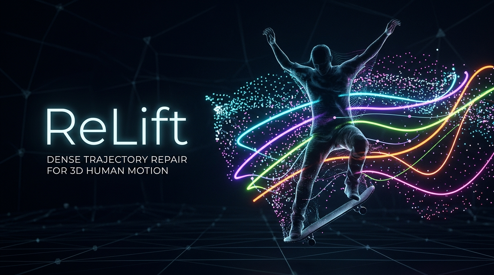

# 🎯 ReLift — Dense 3D Tracking on Mac

> **Running [ReLift: Dense 3D Tracking as Lifted Trajectory Repair](https://relift3d.github.io/) locally on Apple Silicon macOS**

<p align="center">
  
</p>

<p align="center">
  
</p>

<p align="center">
  <a href="https://relift3d.github.io/"></a>
  <a href="https://arxiv.org/abs/2503.17222"></a>
  <a href="https://github.com/relift3d/relift"></a>
  
</p>

---

## 🧠 What is ReLift?

**ReLift** is a state-of-the-art method for **Dense 3D Point Tracking** that works by treating the problem as a *Lifted Trajectory Repair* task.

Instead of tracking points directly in 3D, ReLift:
1. Takes **2D tracks** from an off-the-shelf 2D tracker
2. Takes **monocular depth estimates** from a depth model
3. **Lifts** these into 3D — but lifting introduces errors (scale drift, noise)
4. **Repairs** those lifted trajectories using a learned geometry-only model

> 💡 One geometry-only model works across **any 2D tracker** and **any depth estimator** — making it plug-and-play!

---

## 🚀 My Experiment — Run on MacBook

This repo documents my hands-on experiment running ReLift on **3 video clips** entirely locally on a Mac.

### 📂 Files in This Repo

| File | Description |
|------|-------------|
| `tracks_clip1.mp4` | 🎬 ReLift output — Clip 1 (tracked trajectories) |
| `tracks_clip2.mp4` | 🎬 ReLift output — Clip 2 (tracked trajectories) |
| `tracks_clip3.mp4` | 🎬 ReLift output — Clip 3 (tracked trajectories) |
| `assets/relift_demo.gif` | 🖼️ Side-by-side: Input vs Tracked output |

---

## 🛠️ Setup & Installation (macOS)

### Prerequisites

```bash
# Install conda if you haven't already
brew install --cask miniforge

# Create environment
conda create -n relift python=3.10 -y
conda activate relift
```

### Clone & Install ReLift

```bash
git clone https://github.com/relift3d/relift.git
cd relift

# Install dependencies
pip install -r requirements.txt
pip install torch torchvision --index-url https://download.pytorch.org/whl/cpu
```

> **Note for Apple Silicon (M1/M2/M3):** Use `device=mps` for Metal acceleration, or `cpu` for compatibility.

---

## 🎬 Running on Your Own Videos

### 1. Prepare your video clip

```bash
# Place your video in the input folder
cp your_video.mp4 data/input/
```

### 2. Run ReLift

```bash
python run_relift.py \
  --input data/input/your_video.mp4 \
  --output data/output/ \
  --device cpu   # or mps for Apple Silicon
```

### 3. Visualize tracks

```bash
python visualize_tracks.py \
  --tracks data/output/tracks.npz \
  --video data/input/your_video.mp4 \
  --save tracks_output.mp4
```

The output is a video (`tracks.mp4`) with colorful trajectory lines drawn over each point being tracked through the scene!

---

## 📊 Results

Here are my 3 test clips with ReLift running on a MacBook:

### Clip 1 — `tracks_clip1.mp4`
Dense 3D point tracks visualized on the first video clip.

### Clip 2 — `tracks_clip2.mp4`
Dense 3D point tracks visualized on the second video clip.

### Clip 3 — `tracks_clip3.mp4`
Dense 3D point tracks visualized on the third video clip.

---

## 📖 Paper Reference

```bibtex
@article{singer2025relift,
  title     = {ReLift: Dense 3D Tracking as Lifted Trajectory Repair},
  author    = {Singer, Assaf and Khriesh, Maroun and Rotstein, Noam and Kasten, Yoni and Litany, Or},
  journal   = {arXiv preprint arXiv:2503.17222},
  year      = {2025}
}
```

**Authors:** Assaf Singer*, Maroun Khriesh*, Noam Rotstein, Yoni Kasten, Or Litany  
**Affiliations:** Technion – Israel Institute of Technology, NVIDIA  
*Equal contribution*

---

## 🌐 Links

- 🌍 [Project Page](https://relift3d.github.io/)
- 📄 [Paper (PDF)](https://relift3d.github.io/static/pdfs/relift.pdf)
- 📦 [Official Code](https://github.com/relift3d/relift)
- 🔗 [arXiv](https://arxiv.org/abs/2503.17222)

---

<p align="center">
  <i>Tried and tested on macOS by <a href="https://github.com/ANKARAHAMSA">ANKARAHAMSA</a> 🧪</i>
</p>
